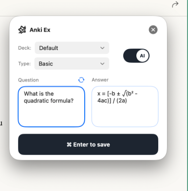

# Lanki

A native macOS menu-bar language-learning assistant. Select any word or sentence
in **any** app (Safari, PDF readers, VS Code, Telegram, …), press a global
shortcut, and a floating popup appears near your cursor with pronunciation,
translation, definition, an example and an optional image — plus a one-click
**Add to Anki** button (via AnkiConnect).

Built with **SwiftUI + AppKit**. No Electron, no Flutter.



## Features

- **Menu bar app** (`LSUIElement`) — no dock icon, always available.
- **Global shortcut** (default `⌘⇧A`, fully re-mappable in Settings).
- **Accessibility API** capture of the current selection, with a clipboard
  fallback for apps that don't expose selection over AX.
- **Floating popup** — borderless, rounded, always-on-top `NSPanel`, positioned
  near the cursor, animated, dismissed on outside click.
- **Dictionary** via [dictionaryapi.dev](https://api.dictionaryapi.dev)
  (definition, IPA pronunciation, audio, examples).
- **Translation** via [MyMemory](https://mymemory.translated.net) — no key
  required; EN→RU by default with from/to language dropdowns.
- **Images** via the [Pexels API](https://www.pexels.com/api/) (optional key).
- **Anki** integration via [AnkiConnect](https://foosoft.net/projects/anki-connect/)
  — creates **Basic** or **Cloze** notes into a deck you choose.
- **History** of recently added words, grouped by day.
- **Settings** for endpoint, deck, card type, languages, API keys, shortcut and
  popup theme (System / Light / Dark).
- **Auto-updates** via [Sparkle](https://sparkle-project.org): Lanki checks once
  a day and shows the standard "Install Update / Remind Me Later / Skip This
  Version" sheet when a new version is out, plus a "Check for Updates…" item in
  the menu bar and Settings.

## Install

### With Homebrew (recommended)

```bash
brew tap rGradov/homebrew-tap
brew install --cask lanki
```

Homebrew verifies the download checksum for you. See `homebrew/README.md` for
the one-time tap setup.

### Manually

Download the `.dmg` from the
[releases page](https://github.com/rGradov/lanki/releases), open it and drag
**Lanki** to your Applications folder.

## Architecture (MVVM)

```
Lanki/
├── App/          LankiApp, AppDelegate, HotkeyManager (capture coordinator)
├── Views/        PopupView, SettingsView, HistoryView, DesignSystem, ShortcutRecorder
├── ViewModels/   PopupViewModel
├── Services/     Accessibility, Hotkey, PopupWindow, Dictionary, Translation,
│                 Anki, Pexels, Audio, Updates (Sparkle), ServiceContainer
└── Models/       WordCard, Language, Hotkey, SettingsStore, HistoryStore
```

## Build & run

Requires macOS 14+ and Xcode 16+ (developed on Xcode 26). Dependencies
([Sparkle](https://github.com/sparkle-project/Sparkle) for updates, plus
`swift-transformers` and `onnxruntime` for offline translation) are resolved by
Swift Package Manager on first build.

```bash
open Lanki.xcodeproj      # then press ⌘R
# or from the command line:
xcodebuild -project Lanki.xcodeproj -scheme Lanki -configuration Debug build
```

## First-run setup

1. **Grant Accessibility access** when prompted (System Settings → Privacy &
   Security → Accessibility → enable **Lanki**). This is required to read the
   selected text. Because the debug build is ad-hoc signed, you may need to
   re-grant it after a rebuild.
2. **Anki**: install the *AnkiConnect* add-on (code `2055492159`) and keep Anki
   running. The default endpoint is `http://localhost:8765`. Use
   *Settings → Anki → Test & Load Decks* to pick your deck.
3. **Pexels** (optional): paste a free API key in *Settings → API Keys* to get
   images on cards.
4. Pick your **languages** in *Settings → Languages* (default English → Russian).

## Usage

1. Select a word or sentence in any app.
2. Press `⌘⇧A` (or your custom shortcut).
3. Review the card in the popup and click **Add to Anki** (or press `⌘↩`).

## Updating

Lanki updates itself in place through [Sparkle](https://sparkle-project.org).
Once a day it checks for a new version; when one is available the update sheet
appears with the release notes and **Install Update / Remind Me Later / Skip This
Version**. Each update is signed with a key that lives only on your machine, and
Lanki refuses any download without a matching signature.

You can also check whenever you like from **Settings → General → Updates**, or
from the menu bar. Turn on **Download updates automatically** to have updates
download in the background and install the next time Lanki quits — then the menu
bar item becomes **Restart to Update to Lanki X.Y**.

If you installed through Homebrew, you can update from the terminal instead:

```bash
brew upgrade --cask lanki
```

Either route keeps your settings, history and downloaded translation models;
they live separately from the app.

## Notes

- Sandboxing is disabled because reading other apps' selection via the
  Accessibility API is incompatible with the App Sandbox.
- Definitions are English-only (dictionaryapi.dev). Translation direction is
  configurable.
